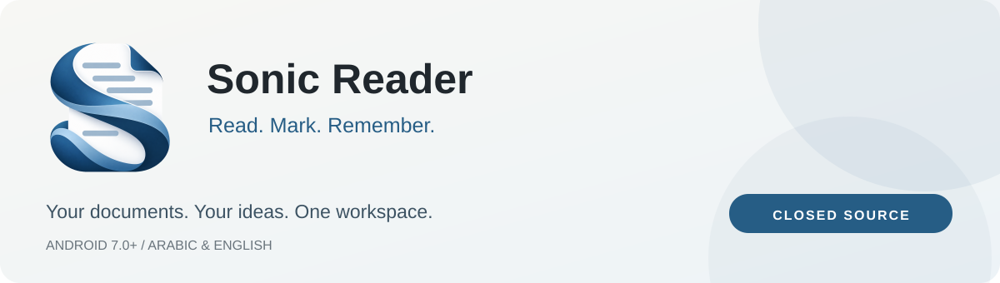
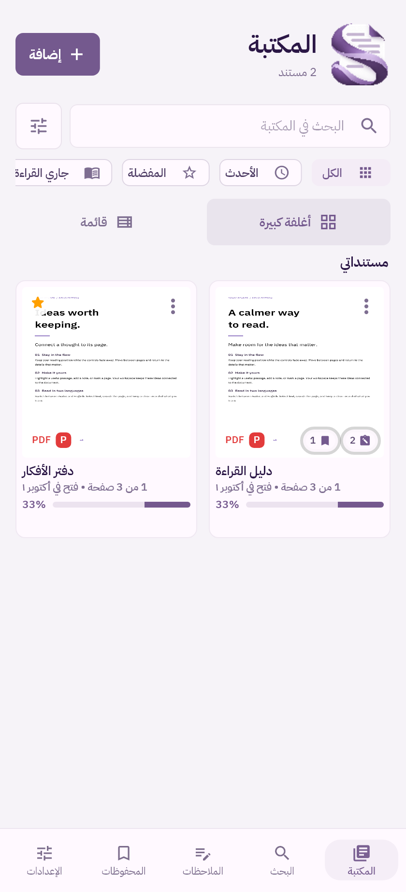
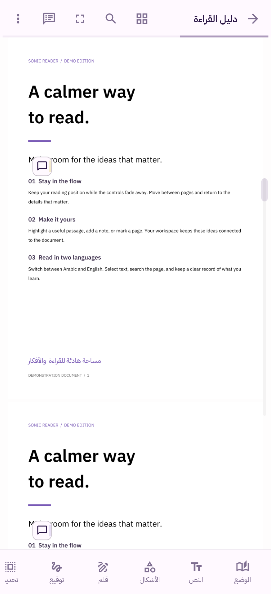
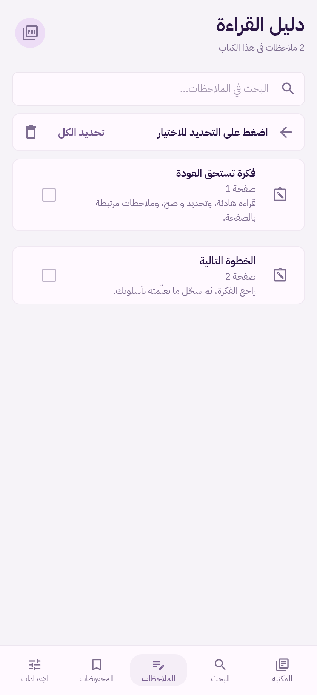

# ⁧Sonic Reader — مساحة هادئة للقراءة والأفكار⁩

⁧**العربية** · [English](README.md) · [تحميل التطبيق](https://github.com/MhDTam/Sonic-Reader/releases/latest) · [الإبلاغ عن مشكلة](https://github.com/MhDTam/Sonic-Reader/issues/new/choose)⁩

⁧**Android 7.0 فأحدث** · **واجهة عربية وإنكليزية** · **قراءة PDF دون إنترنت** · **تطبيق مغلق المصدر**⁩

⁧يجمع Sonic Reader مستنداتك وتعليقاتك وملاحظاتك المرتبطة بالصفحات في مساحة واحدة. اقرأ ملفًا، وحدّد فكرة، ثم عد إلى موضعها عندما تحتاجها.⁩

⁧هذا المستودع مخصّص **لتنزيل التطبيق وتوثيقه**. الكود المصدري للتطبيق خاص وغير منشور هنا.⁩

## ⁧صور من التطبيق⁩

| المكتبة | القارئ | الملاحظات |
| :---: | :---: | :---: |
|  |  |  |

⁧تستخدم جميع الصور مستندات عرض مصطنعة. [المزيد من الصور والواجهة الإنكليزية ←](docs/SCREENSHOTS.md)⁩

## ⁧ما الذي يقدّمه التطبيق؟⁩

- ⁧**قراءة مريحة:** تمرير مستمر لملفات PDF، وتكبير، وبحث، وتنقّل بين الصفحات، وحفظ موضع القراءة.⁩
- ⁧**موضع ثابت للملف:** إظهار شريطي القراءة وإخفاؤهما بحركة سلسة تحافظ على موضع التمرير والتكبير.⁩
- ⁧**تحديد النص:** تحديد العربية والإنكليزية، ونسخ المقاطع، وتمييز الأفكار، مع ترجمة عبر الإنترنت عند طلبها.⁩
- ⁧**التعليق على المستندات:** قلم، وأشكال، ونصوص، وتظليل، وتسطير، وملاحظات لاصقة، وتوقيعات.⁩
- ⁧**دفتر مرتبط بالصفحات:** ملاحظات وإشارات مرجعية قابلة للبحث والتصدير، مرتبطة بالمستند والصفحة.⁩
- ⁧**واجهة تناسبك:** دعم اتجاه العربية والإنكليزية، ومظاهر متعددة، ومفضلة، وطرق مختلفة لعرض المكتبة.⁩

## ⁧التحميل والتثبيت⁩

1. ⁧افتح [أحدث إصدار](https://github.com/MhDTam/Sonic-Reader/releases/latest).⁩
2. ⁧نزّل ملف **`Sonic-Reader-1.0.0-16131.apk`** من قسم **Assets**.⁩
3. ⁧افتح الملف على جهاز يعمل بنظام **Android 7.0 أو أحدث**. قد يطلب Android السماح بالتثبيت من المتصفح أو مدير الملفات الذي اخترته.⁩

⁧يتضمن الملف معمارية **arm64-v8a** و**armeabi-v7a** و**x86_64**. ويرافق الإصدار ملف `SHA256SUMS.txt` للتحقق من سلامة التنزيل.⁩

⁧للإصدارات العامة توقيع مستقل. نسخ التطوير والتجربة الموقّعة بمفتاح آخر لا تقبل التحديث فوقها مباشرة. إذا أبلغ Android عن اختلاف التوقيع، احفظ أو صدّر مستنداتك وملاحظاتك قبل تغيير التثبيت.⁩

## ⁧الميزات التي تحتاج إلى الإنترنت⁩

⁧تعمل قراءة PDF والتعليقات والملاحظات محليًا دون إنترنت. ترسل **الترجمة** النص المحدد إلى Google عندما تطلبها. أما **تحويل Office السحابي الاختياري** فيرسل المستند المختار إلى خدمة التحويل التي تضبطها، بعد الموافقة على الرفع السحابي، ويحتاج إلى اتصال ورمز وصول خاص بتلك الخدمة.⁩

⁧لا تتضمن نسخة النشر **رابط خدمة خاصًا أو حسابًا أو رمز وصول**، والتحويل السحابي معطّل افتراضيًا. يتوفر تحويل محلي أساسي للمحتوى المدعوم في DOCX وXLSX وPPTX، وقد تختلف دقة التنسيق بحسب المستند. لا يتضمن الإصدار العام اشتراكًا في خدمة تحويل مستضافة أو ضمانًا لتوفرها.⁩

⁧[اقرأ معلومات الخصوصية ←](PRIVACY.ar.md)⁩

## ⁧الملاحظات والدعم⁩

⁧استخدم [GitHub Issues](https://github.com/MhDTam/Sonic-Reader/issues/new/choose) للإبلاغ عن مشكلة قابلة لإعادة التجربة، أو اقتراح تحسين، أو تصحيح ترجمة. اذكر إصدار Android ورقم بناء التطبيق وخطوات حدوث المشكلة.⁩

⁧استخدم ملفًا مصطنعًا وصورًا منقّحة. **لا ترفق مستندات خاصة أو كلمات مرور أو رموز وصول أو بيانات حسابات شخصية.**⁩

## ⁧الحقوق والنِّسَب⁩

⁧حقوق النشر © 2026 لحساب [MhDTam](https://github.com/MhDTam). جميع الحقوق محفوظة.⁩

⁧Sonic Reader برنامج **مملوك ومغلق المصدر**. نشر APK الرسمي والتوثيق لا يعني نشر كود التطبيق أو منحه ترخيصًا مفتوح المصدر. راجع [إشعار الحقوق](LICENSE.md).⁩

⁧تبقى المكتبات والخطوط الخارجية خاضعة لحقوق أصحابها وتراخيصها. تشمل نِسَب الخطوط **IBM Plex Sans Arabic من IBM**، وعائلات **خطوط Microsoft وأصحاب الحقوق المعنيين**، وخط **Thmanyah Serif «ثمانية»**. التفاصيل في [إشعارات المكوّنات الخارجية](THIRD_PARTY_NOTICES.md) والإشعارات الكاملة المرفقة بالإصدار.⁩

⁧[سجل التغييرات للإصدار 1.0.0، البناء 16131 ←](docs/CHANGELOG.md)⁩
