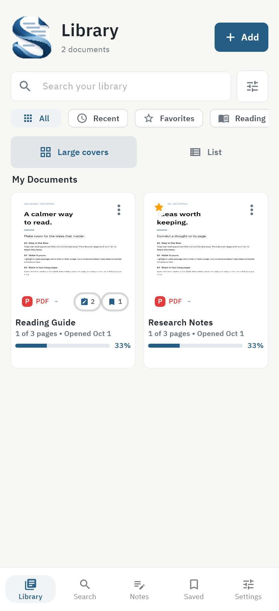
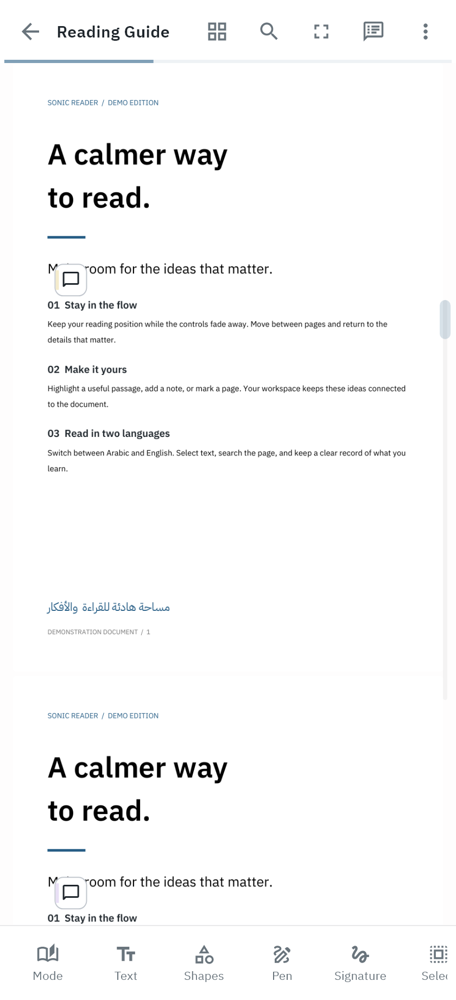
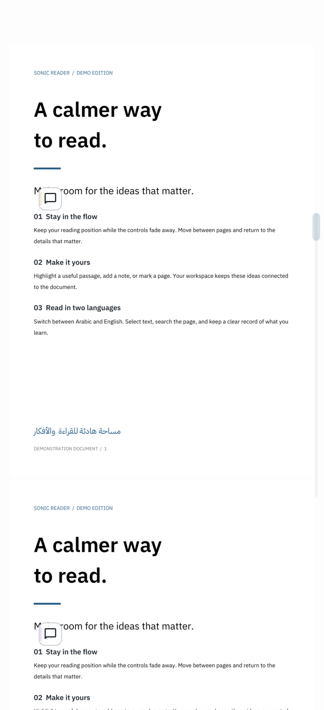
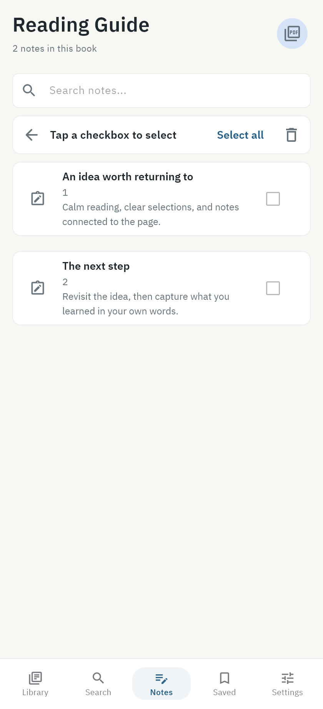
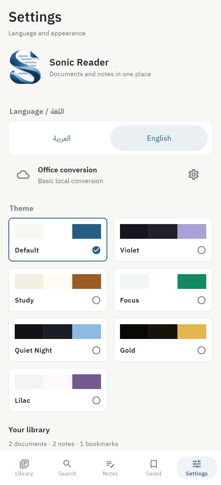
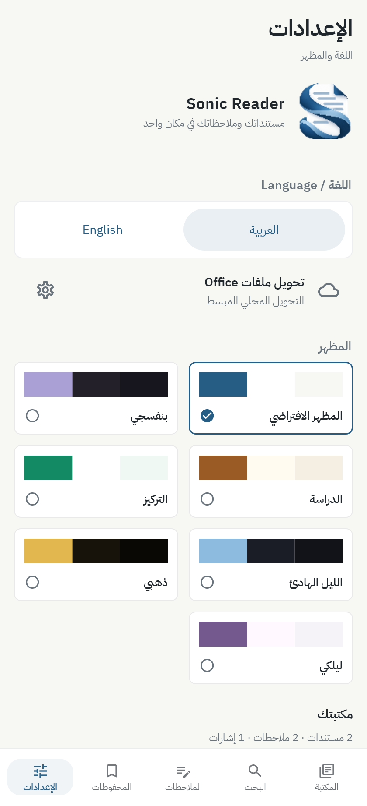

# Screenshots / ⁧صور التطبيق⁩

The screens below use the app's official blue default theme and original S logo.
They are rendered from the app's UI with synthetic demonstration documents and
contain no personal library, account or service configuration.

⁧تعرض الصور المظهر الأزرق الأساسي وشعار S الأصلي للتطبيق، بمستندات عرض مصطنعة، دون مكتبة شخصية أو حسابات أو إعدادات خدمة خاصة.⁩

| Screen | English | العربية |
| --- | :---: | :---: |
| Library / المكتبة |  |  |
| Reader / القارئ |  |  |
| Unobstructed reading / إخفاء الأشرطة |  |  |
| Notes / الملاحظات |  |  |
| Settings / الإعدادات |  |  |
